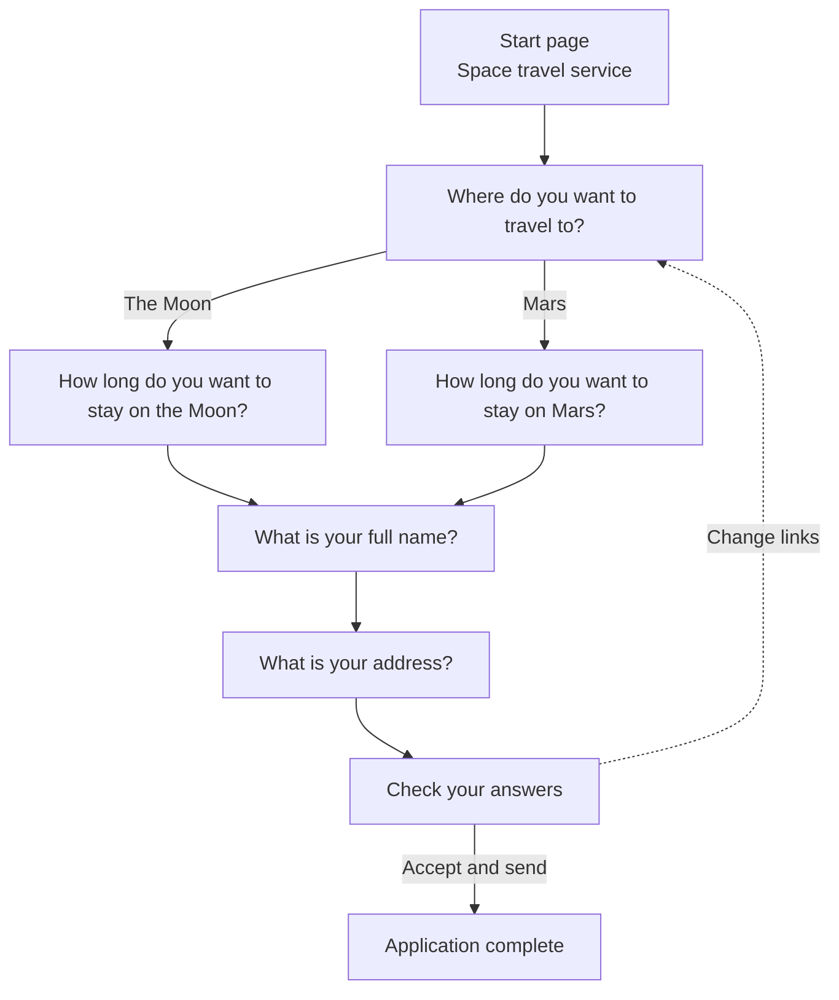

# Space travel service

A prototype for an imaginary GOV.UK service, built with the [GOV.UK Prototype Kit](https://prototype-kit.service.gov.uk/) and the [GOV.UK Design System](https://design-system.service.gov.uk/).

Created for the Mercator Digital Interaction Designer pre-interview exercise.

**Live prototype:** https://space-travel-service-we05.onrender.com

## The journey



| Page | URL | Pattern or component |
|---|---|---|
| Start page | `/` | [Start using a service](https://design-system.service.gov.uk/patterns/start-using-a-service/), start button |
| Destination | `/destination` | [Radios](https://design-system.service.gov.uk/components/radios/) |
| Length of stay on the Moon | `/how-long-on-moon` | Radios (Moon branch) |
| Length of stay on Mars | `/how-long-on-mars` | Radios (Mars branch) |
| Full name | `/full-name` | [Names](https://design-system.service.gov.uk/patterns/names/), text input |
| Address | `/address` | [Addresses](https://design-system.service.gov.uk/patterns/addresses/), multiple text inputs |
| Check your answers | `/check-your-answers` | [Check answers](https://design-system.service.gov.uk/patterns/check-answers/), summary list |
| Application complete | `/confirmation` | [Confirmation pages](https://design-system.service.gov.uk/patterns/confirmation-pages/), panel |

### Branching

The destination answer decides the next question. Each destination has its own length of stay question, with options that suit it. Changing destination removes the other destination's answer, so an answer that no longer applies can never be shown or sent. The branching logic is in [`app/routes.js`](app/routes.js).

### Data passing

Every answer is stored in the session and played back:

- pre-filled when the user returns to a question
- listed on the check your answers page
- the destination is repeated on the confirmation page

After the user reaches check your answers, each **Change** link returns them to the question with their answer filled in. Pressing Continue takes them straight back to check your answers instead of through the rest of the journey. When the application is sent, the answers are cleared, as they would be in a real service.

## Design and accessibility decisions

- **One thing per page.** Each page asks one question, and that question is the page `h1` (`isPageHeading`).
- **Validation and errors** follow the [error message](https://design-system.service.gov.uk/components/error-message/) and [error summary](https://design-system.service.gov.uk/components/error-summary/) guidance:
  - errors are checked on the server
  - the error summary takes focus and links to each field
  - the message tells the user what to do
  - "Error:" is added to the start of the page title
- **Postcodes** are accepted in any case and with or without a space, then stored in the standard format (`sw1a2aa` becomes `SW1A 2AA`).
- **Back links** go to the actual previous page for the branch taken. They don't use `history.back()`.
- **Autocomplete attributes** are set on name and address fields (WCAG 1.3.5, identify input purpose).
- **Field widths** match the expected answer, for example the postcode field is short.
- **Change links** include visually hidden text, for example "Change destination", so screen reader users know which answer each link changes.
- **Pages can't be reached out of order.** For example, the Mars question redirects to the destination question unless Mars was chosen. A direct visit to check your answers goes to the first unanswered question.
- **A phase banner** makes clear this is a prototype.

### Testing

- Both branches, every error state and every change link were tested in a browser.
- [axe-core](https://github.com/dequelabs/axe-core) reported no WCAG 2.2 AA violations on any page, colour contrast included.
- Content reflows at 320px wide with no horizontal scrolling.
- The keyboard tab order follows the visual order.

## Running locally

Requires Node.js 22 or later.

```bash
npm install
npm run dev
```

Then open http://localhost:3000.

## Deployment

Hosted on [Render](https://render.com/) as a Node web service, configured by [`render.yaml`](render.yaml):

- **Build command:** `npm install`
- **Start command:** `npm start`
- **Environment variables:** `NODE_ENV=production`, `NODE_VERSION=22`, `USE_AUTH=false` (an open prototype, so no password is needed)
